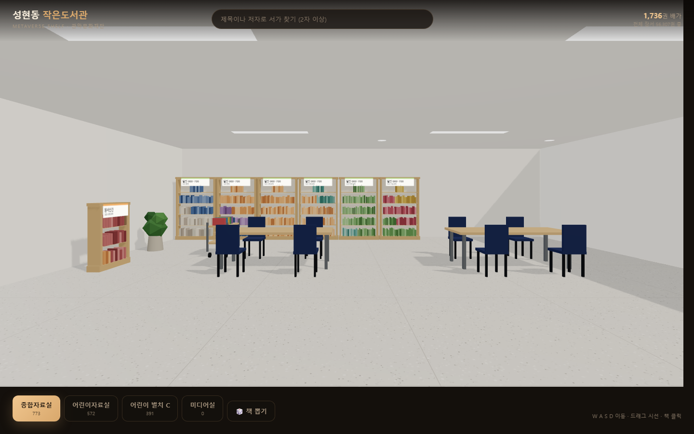

# 성현동 작은도서관 · 메타버스 서가

관악문화재단 성현동 작은도서관의 **실제 장서 데이터(56,307권)** 를 three.js 로 3D 서가에 배가한 개인 프로젝트입니다.
서가에서 책을 클릭하면 표지·책소개와 함께 **이 도서관의 소장 여부 / 대출 가능 여부**를 도서관정보나루 OpenAPI 로 확인합니다.



## 무엇이 진짜인가

| 항목 | 출처 |
| --- | --- |
| 자료실 · 별치기호 · KDC · 청구기호(저자기호) | `itemSrch` (도서관정보나루, libCode `111063`) |
| 표지 이미지 · 책소개 · 대출건수 | `srchDtlList` |
| 소장 여부 · 대출 가능 여부 | `bookExist` (대출 가능은 **전일 기준**) |
| 키워드 검색 | `srchBooks` |

3D 서가는 KDC 000~900 → 청구기호(저자기호) 순으로 실제 배가 순서를 따르며, 자료실은
`종합자료실 / 어린이자료실 / 보존서고` 3개 존으로 나뉩니다. 화면에는 전체 56,307권 중
KDC·자료실 비율을 유지해 표본 2,136권을 배가합니다.

## 기능

- **서가 탐색** — 드래그 회전, 휠 확대, 책 hover 시 제목·저자·청구기호 툴팁
- **책 펼쳐보기** — 클릭하면 카메라가 서가로 이동하고, 책이 튀어나오며 상세 패널이 열립니다
- **소장/대출 확인** — 실시간 API 조회 (미소장·대출중·대출가능 배지)
- **검색** — 현재 배가된 서가에서 즉시 검색, 없으면 도서관정보나루 전체 검색
- **자료실 전환** — 종합자료실 / 어린이자료실 / 보존서고 (`?zone=children` 딥링크 지원)
- **🎲 책 뽑기** — 현재 자료실에서 무작위로 한 권

## 시작하기

```bash
pnpm install
cp .env.example .env      # LIBRARY_API_KEY 에 도서관정보나루 인증키 입력
pnpm dev                  # http://localhost:5173
```

인증키는 [도서관정보나루](https://www.data4library.kr) 회원가입 → Open API 인증키 신청으로 발급합니다.
키는 Vite dev/preview 서버의 프록시(`/api/naru`)가 주입하므로 **브라우저 번들에 포함되지 않습니다.**

## 데이터 다시 만들기

```bash
pnpm harvest     # itemSrch 전체 수집 → data/catalog.json (약 2분, 113회 호출)
pnpm shelves     # 3D 서가용 표본 생성 → public/data/shelves.json
```

`data/catalog.json` 과 `.env` 는 `.gitignore` 에 포함되어 있습니다.

## 스크립트

| 명령 | 설명 |
| --- | --- |
| `pnpm dev` | 개발 서버 (API 프록시 포함) |
| `pnpm build` | 타입 검사 + 프로덕션 빌드 |
| `pnpm preview` | 빌드 결과 미리보기 (프록시 포함) |
| `pnpm test` | 레이아웃 단위 테스트 (Node test runner) |
| `node scripts/browser-check.mjs` | Chrome CDP 로 렌더링·클릭·API 검증 (선택) |

## 구조

```
src/
  api/naru.ts          # 도서관정보나루 클라이언트 (응답 캐시)
  data/layout.ts       # 서가 배치 계산 (자료실 → KDC → 베이 → ㄷ자 배치)
  scene/               # R3F 씬 (Room, ShelfBay, FocusBook, CameraRig)
  ui/                  # Hud, BookPanel (검색·상세 패널)
  store.ts             # zustand 상태 (존/선택/카메라 프리셋)
scripts/
  harvest.mjs          # 전체 장서 수집
  build-shelves.mjs    # 서가 표본 생성
  browser-check.mjs    # CDP 기반 브라우저 검증
```

## 참고

- 대출 가능 여부는 도서관 시스템 동기화 지연이 있어 **전일 기준**입니다. 방문 전 도서관에 확인하세요.
- 3D 서가 위치는 실제 배가 위치를 KDC·별치기호·청구기호로 근사한 것이며, 도서관의 실제 도면과는 다를 수 있습니다.
- 표지 이미지는 도서관정보나루가 제공하는 알라딘 이미지 URL 을 사용합니다.
- 이 프로젝트는 개인 학습·포트폴리오 목적이며 관악문화재단과 무관합니다.
