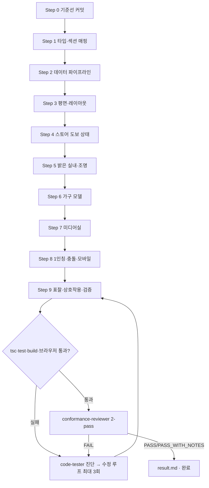

# Plan: 성현동작은도서관 3D 실사 재현 (서가배치도·내부 사진 기반)

- Intent: [INT-001](intent.md) | Tier: 3 | 작성일: 2026-11-11
- Intent updated_at: 2026-11-12T22:20:08+09:00

## 1. Tier 산정
- **Tier 3 (Major)** — 근거:
  - 씬 구조(존·서가 배치·카메라)를 전면 재작성하고 데이터 파이프라인(`scripts/build-shelves.mjs`)과 타입 계약(`ZoneId`, `Bay`, `ZoneLayout`)을 변경하는 구조적 작업이다.
  - 영향 파일이 15개 이상(신규 5개 포함)이고, 기존 테스트·브라우저 검증 스크립트의 전제(`layouts.general`, `rotationY === 0`)가 깨진다.
  - 1인칭 이동·충돌·모바일 UI라는 새로운 상호작용 계층이 추가된다.
- **게이트 판정**: `게이트: 필수(하드) / 근거: ① Tier 3 + ② scripts/ 배포·계약 자산 경로 변경 / 방식: 2-pass`.
- **기준선 주의**: 현재 저장소는 `main` 브랜치에 커밋이 없다(`git log` 실패). 구현 착수 전 **Step 0 기준선 커밋**을 만들지 않으면 단계별 롤백이 불가능하다.

## 2. 실행 순서 (Steps)

### Step 0 — 기준선 확보 (선행 필수)
- 목표: 구현 전 현재 상태를 커밋해 단계별 롤백 지점을 만든다.
- 변경 파일: 없음(`git add -A && git commit`만 수행, `.env`·`data/catalog.json`은 `.gitignore`로 제외 확인).
- 검증: `git log --oneline -1` 확인, `git status --short` 클린.
- 롤백: 불필요(기준선 자체).

### Step 1 — 데이터 모델·섹션 매핑 정의
- 목표: `ZoneId` 4종, `ShelfSection`, `Bay.section`, `ZoneLayout.spawn` 계약과 §6.2 매핑표를 코드로 고정한다.
- 변경 파일: `src/types.ts`, `src/data/sections.ts`(신규), `src/data/layout.test.ts`.
- 선행: Step 0.
- 검증: `pnpm exec tsc --noEmit`(타입 오류는 후속 단계에서 해소), 섹션 매핑 단위 테스트 추가.
- 롤백: `git checkout -- src/types.ts src/data/layout.test.ts && rm src/data/sections.ts`.

### Step 2 — 빌드 파이프라인 갱신
- 목표: `build-shelves.mjs`가 섹션 메타를 방출하고 `other`(구장서)를 제외하며, 섹션별 예산으로 표본을 재생성한다.
- 변경 파일: `scripts/build-shelves.mjs`, `public/data/shelves.json`, `public/data/manifest.json`.
- 선행: Step 1.
- 검증: `node scripts/build-shelves.mjs` → 콘솔 합계 1,736권, `manifest.json` 섹션 수 10, `shelves.json`에 `meta.section` 존재.
- 롤백: `git checkout -- scripts/build-shelves.mjs public/data/shelves.json public/data/manifest.json`.

### Step 3 — 평면 모듈·레이아웃 재작성
- 목표: `floorplan.ts`에 벽·출입구·가구 앵커·존 스폰·충돌 박스를 정의하고, `layout.ts`가 섹션별 베이를 배치도 위치에 생성하도록 재작성한다.
- 변경 파일: `src/data/floorplan.ts`(신규), `src/data/layout.ts`, `src/data/layout.test.ts`.
- 선행: Step 1, 2.
- 검증: 단위 테스트(존 4종, 라벨 10종, KDC 정렬, 빈 베이 없음, 베이 좌표가 평면 bounds 내부), `pnpm exec tsc --noEmit`.
- 롤백: `git checkout -- src/data/layout.ts src/data/layout.test.ts && rm src/data/floorplan.ts`.

### Step 4 — 스토어 도보 상태·이동 API
- 목표: `walk` 상태, `zoneSpawns` 기반 `setZone`, `focusBay`, 선택 시 카메라 비텔레포트를 구현한다.
- 변경 파일: `src/store.ts`.
- 선행: Step 3.
- 검증: 스토어 단위 확인(수동/디버그 브리지), `pnpm exec tsc --noEmit`.
- 롤백: `git checkout -- src/store.ts`.

### Step 5 — 밝은 실내·조명
- 목표: 흰 벽·밝은 천장·테라조 바닥·창/블라인드·패널등으로 `Room`·`LibraryCanvas` 톤을 교체한다.
- 변경 파일: `src/scene/Room.tsx`, `src/scene/LibraryCanvas.tsx`, `src/scene/textures.ts`.
- 선행: Step 3(평면 좌표), Step 4(스폰).
- 검증: 브라우저 캡처에서 어두운 갈색 벽/포그 제거, 콘솔 에러 0.
- 롤백: 위 3개 파일 `git checkout --`.

### Step 6 — 가구 절차 모델
- 목표: 열람 테이블·의자·PC 파티션·북카트·자료실 데스크·낮은 원목 서가·화분을 컴포넌트로 분리해 사진과 유사하게 배치한다.
- 변경 파일: `src/scene/Furniture.tsx`, `src/data/floorplan.ts`, `src/scene/Room.tsx`.
- 선행: Step 5.
- 검증: 존별 가구 개수·충돌 박스 일치, 60fps 목표 확인(개발자 도구 Performance).
- 롤백: `git checkout -- src/scene/Furniture.tsx src/scene/Room.tsx src/data/floorplan.ts`.

### Step 7 — 미디어실·디지털정보실
- 목표: `ON AIR` 유리문, 노란 간판, 내부 모니터·데스크, 디지털정보실 유리벽을 재현한다.
- 변경 파일: `src/scene/Room.tsx`(MediaRoom), `src/data/floorplan.ts`, `src/data/sections.ts`.
- 선행: Step 5, 6.
- 검증: 미디어실 스폰에서 유리문·사인이 보이고 통과 불가, 콘솔 에러 0.
- 롤백: `git checkout -- src/scene/Room.tsx src/data/floorplan.ts src/data/sections.ts`.

### Step 8 — 1인칭 이동·충돌·모바일 UI
- 목표: WASD/방향키 + 마우스 시선(포인터 락), 축 분리 충돌, 모바일 조이스틱·드래그 시선, HUD 안내를 구현한다.
- 변경 파일: `src/scene/Player.tsx`, `src/scene/input.ts`, `src/ui/Hud.tsx`, `src/styles.css`.
- 선행: Step 4, 5, 7.
- 검증: CDP 키 이벤트로 전진·충돌 확인, 390×844 뷰포트 UI 겹침 없음, 포인터 락 거부 시 폴백 동작.
- 롤백: `git checkout -- src/scene/Player.tsx src/scene/input.ts src/ui/Hud.tsx src/styles.css`.

### Step 9 — 표찰·상호작용·검증 스크립트
- 목표: 서가 표찰을 실제 표기로 교체하고, 선택 시 카메라 비텔레포트·검색 이동을 마무리하며, 테스트·브라우저 검증을 새 구조에 맞춘다.
- 변경 파일: `src/scene/ShelfBay.tsx`, `src/scene/FocusBook.tsx`, `src/ui/Hud.tsx`, `src/data/layout.test.ts`, `scripts/browser-check.mjs`.
- 선행: Step 1~8.
- 검증: `pnpm exec tsc --noEmit` · `pnpm test` · `pnpm build` · `node scripts/browser-check.mjs` 모두 통과, 콘솔 에러 0, 캡처 4장.
- 롤백: `git checkout --` 해당 파일들.

## 3. Intent 태스크 매핑
| Plan Step | Intent 태스크 | 내용 |
| :--- | :--- | :--- |
| Step 0 | (선행, 태스크 외) | 기준선 커밋 |
| Step 1 | T-01, T-02 | 타입·섹션 매핑 정의 |
| Step 2 | T-02 | 서가 데이터 파이프라인 갱신 |
| Step 3 | T-01 | 평면·레이아웃 재작성 |
| Step 4 | T-01, T-08 | 스토어 도보 상태 |
| Step 5 | T-03 | 밝은 실내·조명 |
| Step 6 | T-04 | 가구 절차 모델 |
| Step 7 | T-06 | 미디어실·디지털정보실 |
| Step 8 | T-08 | 1인칭 이동·충돌·모바일 |
| Step 9 | T-05, T-07 | 표찰·상호작용·회귀 검증 |

- 누락 태스크: 없음(T-01~T-08 전부 매핑).

## 4. 검증 계획 (DoD)
- **정적 분석·타입**: `pnpm exec tsc --noEmit` → 종료 코드 0.
- **단위 테스트**: `pnpm test` → 0 failures. `layout.test.ts`는 4개 존·10개 섹션·1,736권·정렬·빈 베이 없음·bounds를 검증한다.
- **빌드**: `pnpm build` → 종료 코드 0, 번들 크기 경고는 `chunkSizeWarningLimit` 범위 내 확인.
- **브라우저 검증**: `pnpm dev` + Chrome CDP + `node scripts/browser-check.mjs`
  - 4개 존 로드, 콘솔 에러 0, 책 클릭 → 패널 열림·카메라 비이동, 검색 결과 선택 → 해당 베이 앞 이동, 원격 검색 정상.
  - WASD 전진·벽 충돌, 포인터 락 폴백, 390×844 뷰포트에서 조이스틱·탭 비겹침 확인.
  - `SHOT_PATH`로 스크린샷 1장 저장(존별 4장은 후속 확장).
- **성능**: Performance 패널에서 데스크톱 60fps 목표, draw call·삼각형 수 기록.
- **보안**: 번들에서 `authKey`/`LIBRARY_API_KEY` 문자열 미검출, `/api/naru` 프록시만 사용.
- **정합성 게이트**: `게이트: 필수(하드) / 근거: ① Tier 3 + ② scripts/ 배포·계약 자산 경로 변경 / 방식: 2-pass` — `conformance-reviewer` 2-pass PASS 또는 비차단 근거가 있는 PASS_WITH_NOTES 필요.
- **완료(DoD)**: 위 항목 전부 통과 + `intent.md` 태스크 `[x]` 갱신 + `result.md` 5개 섹션 작성.

## 5. 리스크 · 파급
- **브레이킹 체인지**: `ZoneId`에서 `archive` 제거 → `store`, `Hud`, 테스트, 브라우저 스크립트가 동시에 깨진다. Step 1·9에서 함께 수정하고, 외부 소비자(문서·README)는 없음을 확인했다.
- **데이터 파급**: `shelves.json` 재생성으로 3D 배치 권수가 1,976 → 1,736권으로 줄어든다. HUD의 전체 장서 56,307권 표기는 유지하고 배치 권수를 별도 표기한다.
- **성능 파급**: 가구·유리·조명 추가로 draw call이 증가한다. 공유 재질·병합 지오메트리·그림자 1024 제한으로 완화한다.
- **UX 파급**: 1인칭 전환으로 기존 "드래그 회전·휠 확대" 안내가 무효화된다. HUD 문구·키 안내를 교체한다.
- **자동화 파급**: `scripts/browser-check.mjs`의 베이 탐색을 `rotationY === 0`에서 라벨(`일반 000~700`) 기준으로 바꿔 평면 변경에 덜 취약하게 했다.
- **롤백 기준**: Step 단위 `git checkout`으로 복구한다. 기준선 커밋이 없으면 롤백 불가하므로 Step 0을 생략하지 않는다.
- **미확정 사항**: 배치도 실측 치수 없음(§2 Out-of-scope), 사진 속 가구 수량은 대표값.

## 6. 실행 흐름

