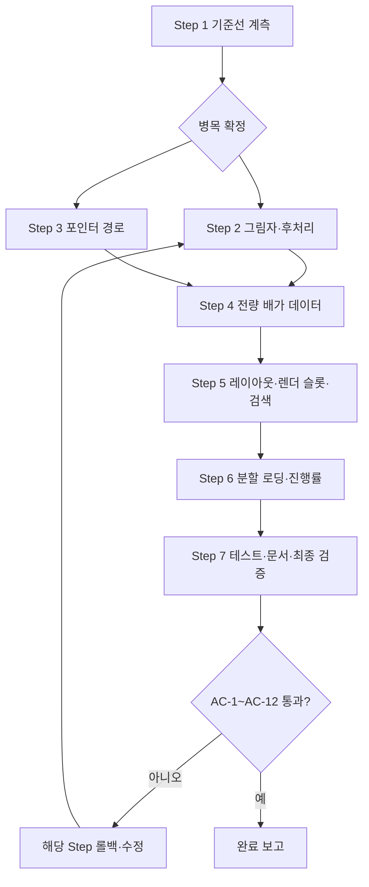

# Plan: 3D 도서관 이동 버벅거림 해소 + 전체 56,307권 KDC 배가

- Intent: [INT-002](intent.md) | Tier: 3 | 작성일: 2026-11-12
- Intent updated_at: 2026-11-12T20:19:46+09:00

## 1. Tier 산정

- **Tier 3 (Major)**.
- **근거**:
  - 변경 범위가 데이터 파이프라인(`scripts/build-shelves.mjs`), 공개 데이터 스키마(`public/data/*`), 레이아웃(`src/data/layout.ts`·`sections.ts`), 렌더(`ShelfBay`·`LibraryCanvas`·`Post`·`Player`), UI(`Hud`·`BookPanel`), 테스트까지 10개 이상 파일에 걸친다.
  - 표본 1,736권 → 전량 56,307권으로 데이터 규모와 스키마가 바뀌어 기존 테스트·문서·구버전 폴백의 회귀 범위가 넓다.
  - `scripts/`는 배포·계약 자산 경로(§A ②)에 해당해 Tier와 무관하게 하드 게이트 대상이다.
- **파괴적 변경 여부**: 데이터 스키마(`shelves.json` → `sections/*.json`)는 내부 소비자만 존재해 브레이킹 체인지는 아니지만, 구버전 폴백을 1릴리스 유지한다.

## 2. 실행 순서 (Steps)

### Step 1 — 성능 기준선 계측 (T-01)
- **목표**: 현재(1차 최적화 포함) 이동 중 평균 FPS·p95 프레임·draw call·후처리 패스를 측정하고 병목 순위를 확정한다.
- **변경 파일**: `scripts/browser-check.mjs`(FPS 샘플러), DEV 전용 `window.__perf`(예: `src/scene/LibraryCanvas.tsx` 또는 신규 `src/scene/perf.ts`).
- **선행**: 없음.
- **검증**: 전진 5초 측정값을 기록하고, 후처리·그림자·hover 중 우선순위를 1줄로 확정한다.
- **롤백**: 계측 코드 제거(제품 동작 영향 없음).

### Step 2 — 렌더 예산: 그림자·후처리 (T-02, T-03)
- **목표**: 정적 그림자 재생성 제거, 비네트+그레이드 병합, 블룸 half-res, AA 경로 단일화로 균형 모드의 프레임 비용을 낮춘다.
- **변경 파일**: `src/scene/LibraryCanvas.tsx`, `src/scene/Post.tsx`, `src/scene/FocusBook.tsx`.
- **선행**: Step 1.
- **검증**: AC-2, AC-12. `?quality=high` on/off 스크린샷 비교와 측정값 비교.
- **롤백**: `?quality=high` 경로는 유지되므로 파라미터 기본값만 되돌린다.

### Step 3 — 포인터 경로 최적화 (T-04)
- **목표**: 포인터 락 중 hover 레이캐스트 제거, 인스턴스 ID 변경 시에만 hover 갱신, yaw/pitch·툴팁 좌표를 rAF로 병합한다.
- **변경 파일**: `src/scene/ShelfBay.tsx`, `src/scene/Player.tsx`, `src/ui/Hud.tsx`, `src/store.ts`.
- **선행**: Step 1.
- **검증**: AC-3, AC-4, 이동·시선 체감 확인.
- **롤백**: 기존 이벤트 핸들러 복원.

### Step 4 — 전량 배가 파이프라인 (T-05)
- **목표**: `data/catalog.json` 56,307권을 존·섹션에 전량 배정하고 섹션 단위 파일·manifest를 생성한다.
- **변경 파일**: `scripts/build-shelves.mjs`, `src/data/sections.ts`, `src/types.ts`, `public/data/sections/*.json`, `public/data/manifest.json`.
- **선행**: 없음(Step 1~3과 병행 가능).
- **검증**: AC-5, AC-7, AC-8. `npm run shelves` 후 `placed=56307`, 중복 0, 누락 0, KDC 정렬 확인.
- **롤백**: 기존 `public/data/shelves.json`을 git에서 복구하고 스크립트를 이전 커밋으로 되돌린다.

### Step 5 — 레이아웃·렌더 슬롯·검색 (T-05, T-06)
- **목표**: `budget` 절단을 제거하고 베이별 전량 목록을 유지하며, 렌더 슬롯 샘플링·표찰 권수·검색 포커스를 구현한다.
- **변경 파일**: `src/data/layout.ts`, `src/scene/ShelfBay.tsx`, `src/scene/FocusBook.tsx`, `src/ui/Hud.tsx`, `src/types.ts`.
- **선행**: Step 4.
- **검증**: AC-6, AC-9. `renderCountOf`·`sourceIndexAt`·`slotOfSource` 단위 테스트.
- **롤백**: 렌더 슬롯 샘플링을 이전 `rows×cols` 고정 방식으로 되돌린다(데이터는 유지).

### Step 6 — 분할 로딩·HUD 진행률 (T-05, T-06)
- **목표**: 스폰 인접 섹션 우선 로드, 나머지 유휴 프리페치, `AbortController` 경합 처리, HUD `n/56,307` 표시.
- **변경 파일**: `src/store.ts`, `src/ui/Hud.tsx`, `src/scene/LibraryCanvas.tsx`, `src/App.tsx`.
- **선행**: Step 4, Step 5.
- **검증**: AC-10, AC-11. 느린 네트워크(throttle)에서 부분 로딩·재시도 확인.
- **롤백**: 단일 `shelves.json` 로드로 되돌린다(임시 플래그).

### Step 7 — 테스트·문서·최종 검증 (T-06)
- **목표**: 1,736/27 고정 단언을 전량 기준으로 갱신하고, README·manifest를 정리한 뒤 전체 검증을 수행한다.
- **변경 파일**: `src/data/layout.test.ts`, `README.md`, `public/data/manifest.json`, `scripts/browser-check.mjs`.
- **선행**: Step 1~6.
- **검증**: `npm run check`, `npm run build`, 브라우저 체크(콘솔 에러 0, 클릭·검색·이동), AC-1~AC-12.
- **롤백**: 테스트·문서 변경만 되돌리고 데이터/코드는 유지.

## 3. Intent 태스크 매핑

| Plan Step | Intent Task | 매핑 내용 |
| :--- | :--- | :--- |
| Step 1 | T-01 | 성능 기준선 실측·병목 확정 |
| Step 2 | T-02, T-03 | 후처리·그림자 1차 최적화 검증 및 보완 |
| Step 3 | T-04 | hover·레이캐스트·setWalk 이벤트 경로 |
| Step 4 | T-05 | 56,307권 전량 배가 데이터 생성 |
| Step 5 | T-05, T-06 | 레이아웃·렌더 슬롯·검색 |
| Step 6 | T-05, T-06 | 분할 로딩·진행률 |
| Step 7 | T-06 | 성능 재검증·회귀·문서 |

- 누락된 Intent 태스크: 없음(T-01~T-06 전부 매핑).

## 4. 검증 계획 (DoD)

- **Tier 3 완료 조건**:
  - `npm run check`(`tsc --noEmit` + `node --test`) 통과.
  - `npm run build` 통과.
  - 브라우저 검증: 콘솔 에러 0, 3D 렌더링, 책 클릭·검색·이동·존 전환, `?quality=high` 토글.
  - 성능: AC-1(데스크톱 평균 60fps, p95 ≤ 20ms)과 AC-2~AC-4 통과.
  - 데이터: AC-5~AC-10(전량 56,307, 중복·누락 0, 정렬·용량·검색).
- 게이트: 필수(하드) / 근거: ② 배포·계약 자산 경로(`scripts/`) 변경 / 방식: 2-pass
- **정합성 검증**: `code-tester` 이후 `conformance-reviewer` 2-pass(순방향 → 반증 전용). `PASS` 또는 비차단 근거가 있는 `PASS_WITH_NOTES`만 완료 인정.
- **롤백 기준**: AC-1 미달, 콘솔 에러 발생, 데이터 중복·누락 1건 이상이면 해당 Step을 롤백하고 재검증한다.

## 5. 리스크 · 파급

- **시각적 기대 불일치**: A-1 채택 시 56k 전량이 개별 스파인으로 보이지 않는다. 표찰 권수·검색으로 보완하지만 사용자가 "전부 눈에 보이는 배가"를 기대하면 재협의가 필요하다.
- **데이터 사실성**: `other` 31,352권을 종합에 배정하는 A-2는 실제 구장서라면 왜곡이다. 매핑 함수를 1곳에 격리해 변경 비용을 낮춘다.
- **로딩 성능**: `gen-000-700` 섹션이 약 27k권으로 커져 첫 로드가 느려질 수 있다. 스폰 인접 섹션 우선 로드·프리페치·gzip으로 완화한다.
- **저장소 크기**: 56k 생성물이 git 추적 대상이라 커밋 diff가 커진다. 압축 스키마(튜플)와 섹션 분할로 완화한다.
- **회귀**: `budget` 제거로 `layout.ts:63` 구버전 폴백, `layout.test.ts:64`·`:124`·`:288`, `README.md:5`가 깨진다. Step 7에서 전량 기준으로 갱신한다.
- **그림자 고정**: `shadowMap.autoUpdate=false`·ContactShadows `frames=1`로 선택 책·플레이어 접지 음영이 고정될 수 있다. 선택 변경 시 `needsUpdate`로 보완하고 시각 허용 여부를 확인한다.
- **동시 작업 충돌**: 1차 최적화는 커밋 `1d39567`로 반영되었다. 성능 변경은 이 커밋 위에서 별도 커밋으로 분리해 충돌을 줄인다.
- **브레이킹 체인지**: `public/data/shelves.json` → `sections/*.json` 전환. 앱 내부 소비자만 있으므로 외부 영향은 없으나, 구버전 폴백을 1릴리스 유지한다.

## 6. 실행 흐름

